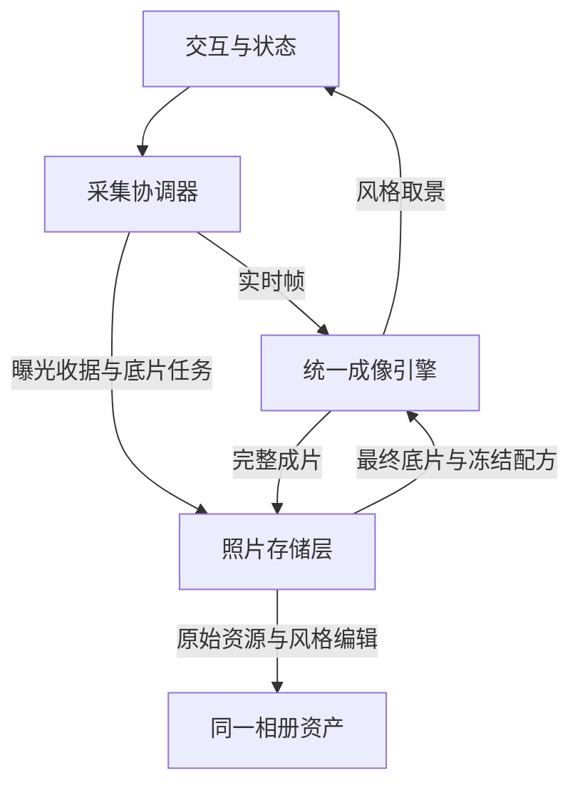

# Camera18 统一相机模拟技术方案

日期：2026-10-28。状态：本分支已实现引擎v5及v2配方，尚待原生和真机验收；ProRAW准入仍待实测。具体实现与边界以 ARCHITECTURE.md 为准。

## 目标与默认决策

用户只选择相机、调整光圈与焦段、按下快门。取景时能够感知风格，拍摄可以连续进行，成片保持预览中的色彩性格，并在普通观看尺寸下呈现清楚、协调、有辨识度的相机质感。

默认高质量 HEIF 采集；一个共享成像引擎；一套版本化配方；同一份底片与一个相册资产。主要升级集中于明暗关系、颜色响应和细节表现。推荐真实光圈联动继续作为产品核心。

ProRAW 是值得验证的底片候选，不在本轮直接成为默认，也不增加用户模式或常驻双路拍摄。先用同一渲染器比较实际收益，胜出后再通过输入适配替换受支持设备的来源。充分利用苹果能力，以成片与响应共同受益为准。

## 用户流程与可感知效果

| 时刻 | 用户感受到的结果 | 技术约束 |
| --- | --- | --- |
| 打开相机 | 熟悉的相机与色彩，取景及时可用 | 恢复上次相机；预热采集与当前配方；分析任务不阻塞首帧 |
| 切换相机 | 当前画面立刻呈现不同性格，光圈按相机联动 | 只运行当前风格；光圈等待真实回读，未到位不抢拍 |
| 拧动光圈 | 连续的操作反馈与真实光学变化 | 界面拖动顺畅，松手提交硬件；模拟不伪造大画幅景深 |
| 按下快门 | 按钮响应明确，曝光完成有可信反馈 | 按压触感与曝光成功分开；接受失败不得显示成功闪屏 |
| 继续拍摄 | 上一张的风格处理与保存不阻塞下一张 | 复用现有有界队列、状态门禁与后台任务 |
| 查看成片 | 照片延续取景风格，细节更完整，可直接分享 | 最终底片才生成交付照片；处理状态复用现有入口 |

实时取景不是最终曝光。不得把任意视频帧、延迟代理或过渡画面保存、分享或标为最终照片。无需为本次升级增加教学、后期滑块、格式开关或新的照片管理页面。

## 三个职责与唯一数据流

沿用三个原生职责，React Native 只处理交互和状态，不接收全尺寸像素。

| 模块 | 职责 | 不负责 |
| --- | --- | --- |
| CameraEngineModule | 能力选择、采集、焦段与真实光圈、曝光收据；输出帧和最终底片任务 | 风格像素处理、相册事务 |
| CameraProfileRenderer | 输入适配、画面分析、统一成像处理；供实时取景、成片与离线工具共用 | 拍摄会话、保存重试、试拍结算 |
| CameraPhotoStore | 冻结任务、取回最终底片、调用同源渲染、同资产编辑、恢复与交付 | 另一套滤镜、品牌特例、用户交互控制 |

每次拍摄冻结 captureID、相机配方及版本、颜色约定、渲染器版本和场景适应的边界。最终采用的场景上下文与配方一起写入Photos编辑数据，保留可追溯性。请求光圈与预览参数只作诊断；实际镜头、光圈、ISO、快门与尺寸以采集结果为准。旧任务不读取用户后来选中的相机。

原图保留、PhotoKit 权限回退、按 ID 幂等结算、重启恢复及存储管理全部复用[高画质采集架构](高画质采集架构.md)，不另建照片任务系统。

## 采集与底片选择

### 本轮默认

- `.photo`，输出与单次 `.quality`；HEIF 优先，必要时 JPEG。支持且有读取权限时采用24MP延迟处理，否则直接交付高质量底片；实际尺寸服从设备与系统。
- AF、AE、ISO、快门、AWB 自动；保留支持的响应式拍摄与零快门延迟，不为快速连拍自动降低质量等级。
- 默认苹果虚拟后置多摄；推荐或主动真实光圈控制按既有契约绑定支持的物理主摄。不得为降噪取消推荐光圈或偷偷改大光圈。
- 延迟代理只入库，取回苹果最终底片后才渲染。无读取权限走既有直接交付路径，使用同一个渲染器与输出约定。

### ProRAW 的明确准入

ProRAW 可以在保留部分苹果多帧处理的同时，把更多影调与细节决定权留给应用，但有额外资源成本。不能假设它与24MP延迟、多摄、光圈控制在所有设备上同时兼容。

工程以固定构图和相近拍摄条件，对比当前HEIF与ProRAW自定义显影；均进入同一成像引擎，并统一观看尺寸。比较普通尺寸美感、细节、高光、暗光、切换与连拍响应、处理耗时、内存和发热。RAW 9 等能力仅在实际文件和系统支持时加入对比，不以“开启新API”作为收益证据。

只有风格与画质稳定改善、推荐光圈有效、响应和资源验收同时通过，才将ProRAW作为受支持设备的固定采集策略。决策按设备与采集配置发布，不按每张照片或每个品牌随意切换；失败回退到已验证来源。输入显影属于输入适配，不复制风格引擎。未通过前不加入生产占位代码或隐藏开关。

## 一个成像引擎的固定顺序

这里的阶段是同一渲染器内部职责，不要求建立独立服务、插件或管理器。

| 顺序 | 阶段 | 具体任务与边界 |
| --- | --- | --- |
| 1 | 输入适配 | 正确解释来源、方向、色彩空间与动态范围；根据实测修正预览／成片及不同镜头偏差。没有校准则保持identity，不假装能撤销苹果已完成的处理 |
| 2 | 画面分析 | 在小图上估计亮度分布、高光、暗部与肤色／主体置信度；与风格无关，不因换相机重复运行。无需在界面显示分析工具 |
| 3 | 细节与光学响应 | 按配方有界调整不同尺度的细节，抑制生硬描边同时保留纹理；如参考确有需要，再加入克制的高光散射。拒绝全图模糊、假背景虚化和凭光圈数字生成假星芒 |
| 4 | 影调与色彩 | 先建立高光过渡、黑位、中间调层次，再应用明确输入域的相机色彩响应；有限的肤色保护融入同一结果。每项变化只由一处负责，避免LUT与外部曲线重复压高光、重复染色 |
| 5 | 表面质感 | 统一管理暗角及可选颗粒，按画面尺寸与实际镜头条件计算；默认零额外颗粒。只在参考与验收支持的配方中启用，不给所有模式叠同一层噪点 |
| 6 | 显示与输出 | 从内部浮点结果一次转换到明确的sRGB SDR成片；预览与相册查看采用相同显示意图。HEIF优先、JPEG回退，保存真实元数据及配方 |

散射等需要线性光计算的阶段在影调映射前完成；不能让0–1范围的LUT提前裁掉尚未完成映射的高光。内部保持浮点精度，不在阶段间反复8位编码。风格SDR输出不沿用原底片HDR增益图；原始HDR资源仍保留。将来需要HDR风格输出时，须另验SDR/HDR一致性与新的增益图生成，不直接复制旧图。

当前 `deharsh` 只承担高光色彩缓和；升级时明确它的职责，不能把它当成已实现的边缘柔化。新阶段改变处理顺序与色彩约定，必须升级renderer和recipe版本，原生identity/灰阶/色域测试通过后迁移；现有旧配方不直接套入新顺序。

## 一份配方与有限自适应

所有相机继续由 `assets/camera-profiles.json` 及引用的LUT定义。每台相机给出一个最显著的特征和少量辅助特征，体现于照片的中间调、高光、主要颜色和细节，而不是只改变界面名称。

配方表达推荐光圈、影调、色彩、细节、可选光学／颗粒及适应范围；只增加渲染器确实消费的字段。目标是同一套参数语义覆盖八种模式，不按品牌编写分支，也不额外维护一组“预览配方”。

LUT保存颜色响应，影调由统一影调阶段控制。新候选必须去掉源LUT已包含的重复效果或重新标定；不能在未知LUT上继续叠加强度。旧用户override保留，可导出和恢复，不静默重写。

自适应只保护基本观感：限制肤色异常偏色、高光通道硬裁切和暗部彩色噪点被放大；不得自动把所有相机纠正成同一颜色。主体蒙版仅用于色彩与明暗保护，不用于磨皮、换背景或生成虚化。置信度不足时减弱局部处理并平滑回到整体方案，不等待模型完成才显示预览。

真实光圈直接控制采集。渲染只在取得实际镜头与光圈数据、且有测量依据时补偿剩余差异，避免重复加暗角或重复柔化。没有测量时不加“光圈越大就越朦胧”的规则。相同ƒ值不等于不同画幅相机的等效景深。

## 预览与成片如何一致且顺畅

- 预览、最终照片、缩略图与离线校准共用相同的风格定义及处理顺序；差别限于分辨率和采样精度。小尺度纹理随输出尺寸换算，不能在预览和成片中具有不同强度含义。
- 预览只渲染当前相机，按现有分辨率上限运行；输入分析在低分辨率独立队列上限频复用，不每帧跑全尺寸Vision。结果做时间平滑，避免色彩抽动；镜头切换时作废旧上下文。
- 最终照片使用本次曝光和冻结配方，重新分析实际最终底片；只允许在同一适应边界内细化，不重新选择风格或突然改变主体亮度。苹果多帧结果不同于视频帧，验收目标是观感连续，不承诺逐像素一致。
- 静态配方按内容版本编译缓存；光圈位置、场景数据作为动态输入，不随每次拖动重建LUT。复用共享GPU context及纹理，所有全尺寸处理留在原生后台队列。
- 曝光完成与最终渲染保存分离，复用现有活动任务上限和串行成片处理。资源不足先减少分析频率和预览采样成本，保留风格意图与成片质量；仍不足则明确忙碌，不无限排队。
- 正常成片使用现有单张预览与分享；等待或失败复用照片状态入口。保留的底片不能被误报为风格完成，恢复不重复加滤镜、不重复创建资产、不重复扣试拍。

## 用成片决定是否完成

优先级为：拍摄可靠与流畅、普通观看尺寸的美感与辨识度、放大细节、对目标相机的接近程度。不能用颜色误差或静态检查代替前两项。

| 验收项 | 通过条件 |
| --- | --- |
| 风格可感知 | 同一场景、普通手机显示尺寸，代表风格可在不看名称时区分；不靠模糊、严重偏色、过曝或噪点制造区别 |
| 美感改善 | 旧／新方案匿名盲比在独立日常场景中稳定优于旧方案；肤色、白衣和高光不以风格差异为由明显退化 |
| 光圈有效 | 推荐值与手动值按实际能力执行并回读；对不同真实光圈比较采集与成片，固定光圈设备不虚构效果 |
| 预览连续 | 切相机后色彩变化及时，目标稳定30fps；初始工程目标为已就绪时风格更新P95不超过150ms。成片不突然换色、脸变亮或加重颗粒 |
| 拍摄响应 | 下一次可拍不等待上张风格处理；新增阶段不显著降低同设备基线拍摄吞吐。长曝光、光圈调整与系统限流单独记录，不伪造统一快门耗时 |
| 细节与资源 | 100%查看无新增明显锐化光边、蜡感和光晕接缝；连续拍摄与反复预览后内存可回落，无持续缓存增长；测量P50/P95耗时与温升 |
| 交付可信 | 原图、完整风格图、缩略图和captureID对应；权限／后台／重启／失败路径仍通过既有生命周期验收 |

性能数字为设计目标，并非已测结果；目标设备按能力分组验收。30fps是稳定取景目标，不通过隐藏成片降质达成。

先用自然细腻与鲜明复古两种代表性配方验证引擎，再在同一引擎中完成现有八模式。参考集分为美感目标样片和真实相机配对样片：前者可以指导创作，后者支持真实还原标定。缺少实测数据时仍可改进美感，但保持approximation，不宣称精准复刻。数据、盲比、训练／验收分离和原生工具沿用[相机校准流程](相机校准流程.md)，工程负责执行，不让用户反复切设置排查。

## 实施顺序

1. **统一引擎**：建立输入与显示约定，明确影调／颜色／细节职责，加入有界画面分析与风格适应；两种代表配方通过画面、响应与原生验证。现有采集、光圈与保存复用。
2. **完成产品效果**：在同一引擎中校准八模式，完成实时取景与成片一致性、普通尺寸美感盲比及复杂场景验收；仅加入有证据有收益的光学／颗粒效果。
3. **决定底片升级**：用相同验收对比ProRAW／受支持RAW处理。达到准入要求才替换对应设备的来源；不达标继续HEIF，不新增用户决策或第二套渲染系统。

本轮已实现共享成像阶段、有限场景保护、七种风格的v2配方、旧配方兼容、性能诊断及同源ProRAW离线对比命令。ORIG保留。没有实测配对相机数据，配方保持approximation；当前没有开启光晕、额外颗粒、软件景深、原生语义人像分割或ProRAW生产采集。代码与静态检查不代替原生像素、盲比、响应、内存和硬件验收。未触发构建。

## 苹果公开能力依据

- [高分辨率与延迟照片交付](https://developer.apple.com/videos/play/wwdc2026/304/)：支持范围、质量与响应取舍。
- [ProRAW捕获与显影](https://developer.apple.com/videos/play/wwdc2021/10160/)：计算摄影底片与可调整的默认显影。
- [RAW与ProRAW能力查询](https://developer.apple.com/documentation/avfoundation/capturing-photos-in-raw-and-apple-proraw-formats)：不同来源及设备配置支持。
- [RAW 9与Core Image](https://developer.apple.com/videos/play/wwdc2026/305/)：按支持启用的RAW处理与资源要求。
- [Vision主体蒙版](https://developer.apple.com/documentation/vision/applying-matte-effects-to-people-in-images-and-video)：局部颜色与明暗处理的输入。
- [HDR编辑与增益图](https://developer.apple.com/videos/play/wwdc2024/10177/)：编辑后输出的动态范围一致性。
